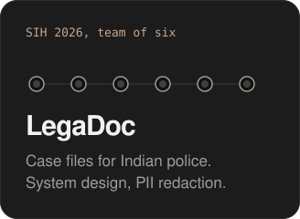
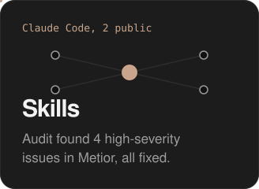
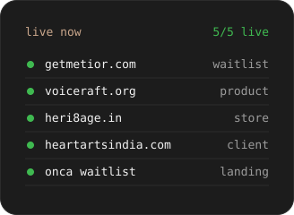
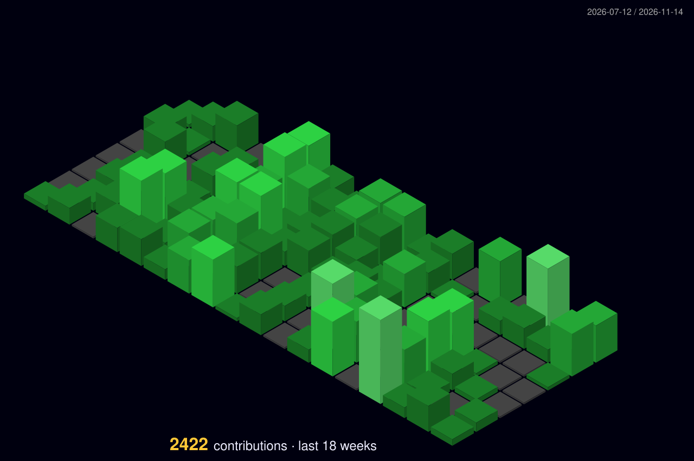

<picture>
  <source media="(prefers-color-scheme: dark)" srcset="assets/header-dark.svg">
  
</picture>

CS student at Manipal University Jaipur (2025 to 2029). Right now I'm building Metior, bookkeeping software for Indian small businesses, and Voiceraft, which answers phone calls for businesses. I also write Claude Code skills and use them on my own projects.

 

Skills on GitHub: [`reasoning-core`](https://github.com/Ishaan-nasir/reasoning-core) · [`handover`](https://github.com/Ishaan-nasir/handover)

### Shipped

| Project | Type | Built |
|---|---|---|
| [heri8age.in](https://heri8age.in) | D2C store | stock reservation, GST invoicing, fulfilment, admin panel |
| [heartartsindia.com](https://heartartsindia.com) | Client site | Next.js and Supabase, CMS with 94 editable fields |
| [ONCA waitlist](https://onca-waitlist-navy.vercel.app/) | Landing page | early-access signups for ONCA |
| [mt5-mac-python-bridge](https://github.com/Ishaan-nasir/mt5-mac-python-bridge) | Tool | MetaTrader 5 from Python on macOS, no Wine or VPS |
| [SnapCal](https://github.com/Ishaan-nasir/SnapCal) | Tool | photo of a timetable to an `.ics` calendar file |

### Elsewhere

- Dev Relay Hackathon: second place with Team Redact
- Smart India Hackathon 2026: top 95 with LegaDoc
- Google Developer Groups on Campus, MUJ: technical team

### Stack

[Email](mailto:contact.ishaannasir@gmail.com) · [LinkedIn](https://www.linkedin.com/in/ishaan-nasir/) · [getmetior.com](https://getmetior.com) · [voiceraft.org](https://voiceraft.org)
